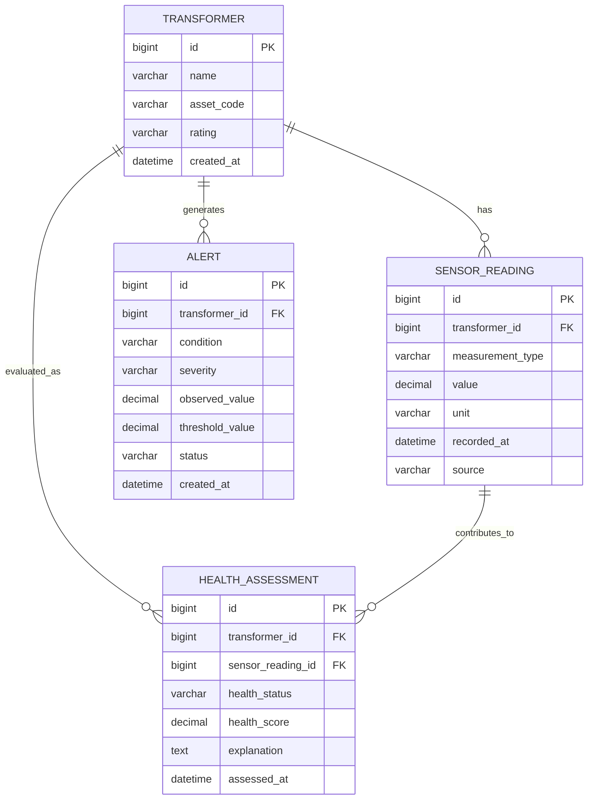

# Database Schema Specification — Transformer Digital Twin

**Status:** Approved schema baseline — initial JPA entity mapping implemented  
**Basis:** Approved BRD, PRD and Technical Architecture Proposal  
**Database recommendation:** MySQL with Spring Data JPA / Hibernate  
**Scope:** One transformer, simulated sensor readings, health assessments, degradation alerts and reviewable history.

---

## 1. Scope and traceability

The approved requirements require:

- Simulated sensor data to drive a live transformer-health view.
- Alerts when health degrades.
- Historical information that can be reviewed.

The approved architecture proposes four primary tables:

1. `transformer`
2. `sensor_reading`
3. `health_assessment`
4. `alert`

The assignment does **not** prescribe a database, exact columns, health-score formula, sensor list, thresholds, alert lifecycle, retention period or number of assets. MySQL and the schema below are architecture choices. Fields or behaviours marked optional must not be treated as mandatory assignment requirements.

## 2. Entity relationship model

**Relationship note:** an assessment may depend on multiple readings rather than one reading. The `sensor_reading_id` relationship shown in the approved architecture is therefore a simplified initial proposal. Before implementation, decide whether an assessment references one triggering reading, a set of readings, or only the assessment timestamp and transformer. Do not force a one-reading relationship if the selected health rules evaluate several measurements together.

## 3. Table specifications

### 3.1 `transformer`

Represents the transformer being monitored.

| Column | Suggested type | Required? | Description |
|---|---|---:|---|
| `id` | BIGINT | Yes | Primary key |
| `name` | VARCHAR(120) | Yes | Display name |
| `asset_code` | VARCHAR(80) | TBD | Human-readable asset identifier |
| `rating` | VARCHAR(80) | TBD | Optional descriptive rating; exact transformer specification is not defined |
| `created_at` | DATETIME/TIMESTAMP | Yes | Record creation time |

**Constraints and notes**

- `id` is the primary key.
- If `asset_code` is used, decide whether it must be unique.
- One preconfigured transformer is sufficient for the proposed prototype.
- Do not invent a transformer rating or manufacturer as a fact. Any sample asset details must be labelled as demo data.

### 3.2 `sensor_reading`

Stores each simulated measurement as a time-stamped record. New readings should be inserted rather than overwriting the previous reading, so history remains available.

| Column | Suggested type | Required? | Description |
|---|---|---:|---|
| `id` | BIGINT | Yes | Primary key |
| `transformer_id` | BIGINT | Yes | Foreign key to `transformer.id` |
| `measurement_type` | VARCHAR(60) | Yes | Measurement category, e.g. `OIL_TEMPERATURE`, `LOAD` |
| `value` | DECIMAL(12,4) | Yes | Numeric measurement value |
| `unit` | VARCHAR(20) | Yes | Unit associated with the value |
| `recorded_at` | DATETIME/TIMESTAMP | Yes | Time the simulated reading represents |
| `source` | VARCHAR(20) | Yes | Provenance; proposed initial value `SIMULATED` |

**Constraints and notes**

- `transformer_id` references `transformer.id`.
- `measurement_type` must identify a measurement supported by the implementation.
- `unit` must match the measurement type.
- Store timestamps consistently; the architecture recommends UTC storage and local-time display.
- The architecture proposes oil temperature, winding hot-spot temperature and load as a minimal initial selection. This selection still requires confirmation and domain research.
- Dissolved gas and partial discharge are examples in the assignment, not mandatory columns or measurements.
- `source` is a provenance safeguard proposed by the architecture. It should not imply that real sensors are connected.

### 3.3 `health_assessment`

Stores the result of evaluating the transformer condition at a point in time.

| Column | Suggested type | Required? | Description |
|---|---|---:|---|
| `id` | BIGINT | Yes | Primary key |
| `transformer_id` | BIGINT | Yes | Foreign key to `transformer.id` |
| `health_status` | VARCHAR(30) | Yes | Result of the configured health assessment |
| `health_score` | DECIMAL(5,2) | Optional | Only if a defined, explainable score is implemented |
| `explanation` | TEXT | Optional | Human-readable explanation of the assessment |
| `assessed_at` | DATETIME/TIMESTAMP | Yes | Assessment timestamp |
| `sensor_reading_id` | BIGINT | TBD | Optional reference to a triggering reading, if the assessment is based on one reading |

**Constraints and notes**

- `transformer_id` references `transformer.id`.
- Do not store a numeric health score unless its calculation and meaning are explicitly defined.
- The architecture suggests `NORMAL`, `WARNING` and `CRITICAL` as candidate statuses, but the status set and criteria are not assignment requirements and remain to be finalized.
- An explanation is useful for showing why health changed, but its exact format is an implementation choice.
- If an assessment uses multiple readings, use a suitable relationship or record the evaluated measurement context in another explicit way. This is an open schema decision, not a reason to misrepresent a multi-input assessment as a single-reading assessment.

### 3.4 `alert`

Stores degradation events generated by the health-assessment logic.

| Column | Suggested type | Required? | Description |
|---|---|---:|---|
| `id` | BIGINT | Yes | Primary key |
| `transformer_id` | BIGINT | Yes | Foreign key to `transformer.id` |
| `condition` | VARCHAR(120) | Yes | Degradation condition or rule identifier |
| `severity` | VARCHAR(20) | TBD | Optional severity classification |
| `observed_value` | DECIMAL(12,4) | TBD | Value associated with the trigger, when applicable |
| `threshold_value` | DECIMAL(12,4) | TBD | Configured threshold, when the rule uses one |
| `status` | VARCHAR(20) | TBD | Optional lifecycle state |
| `created_at` | DATETIME/TIMESTAMP | Yes | Alert creation time |

**Constraints and notes**

- `transformer_id` references `transformer.id`.
- An alert must be associated with the transformer and condition that caused it, to the extent supported by the chosen rule.
- Severity and lifecycle fields are design choices; the assignment only requires visible alerts when health degrades.
- The architecture proposes `ACTIVE`, `ACKNOWLEDGED` and `RESOLVED` as a possible lifecycle. A simpler implementation may store only an active alert if that is sufficient.
- If duplicate suppression is implemented, its key and behaviour must be documented. Do not assume a particular deduplication window or reset rule without deciding it.

## 4. Proposed keys, constraints and indexes

### Primary and foreign keys

| Table | Key |
|---|---|
| `transformer` | `id` primary key |
| `sensor_reading` | `id` primary key; `transformer_id` foreign key |
| `health_assessment` | `id` primary key; `transformer_id` foreign key |
| `alert` | `id` primary key; `transformer_id` foreign key |

An optional `health_assessment.sensor_reading_id` would reference `sensor_reading.id` only if the assessment-to-reading relationship is confirmed.

### Recommended indexes

| Index | Reason |
|---|---|
| `sensor_reading(transformer_id, recorded_at)` | Retrieve a transformer's readings over a time range |
| `health_assessment(transformer_id, assessed_at)` | Retrieve historical health assessments |
| `alert(transformer_id, created_at)` | Retrieve alerts for a transformer in chronological order |

These are performance recommendations for the proposed history queries, not explicit assignment requirements.

## 5. Data lifecycle and processing expectations

The schema supports the following proposed processing sequence:

1. The backend simulator generates a reading.
2. The backend validates the measurement type, value, unit and timestamp.
3. The reading is inserted into `sensor_reading`.
4. The health service evaluates the available readings using documented rules.
5. The assessment is inserted into `health_assessment`.
6. If degradation is detected, an alert is inserted or an existing active alert is handled according to the chosen deduplication policy.
7. A real-time event is published to connected dashboard clients.

The reading, assessment and alert operations should be coordinated so that the UI does not show an alert or health state that was not persisted successfully. The exact transaction boundary is an implementation detail to decide during development.

## 6. Retention and history

The assignment requires history that users can look back through. It does not define a retention period.

For the prototype:

- Preserve generated readings for the duration of the demonstration.
- Preserve health assessments and alerts so the history view can show earlier states.
- Do not overwrite historical readings with the latest value.
- Do not add a scheduled deletion policy unless a retention requirement is later agreed.

A production retention strategy is outside this assignment baseline.

## 7. Data validation considerations

These are implementation safeguards, not additional source requirements:

- Reject or explicitly handle unknown measurement types.
- Keep units consistent with measurement types.
- Do not treat missing or invalid measurements as normal measurements.
- Use a consistent timestamp convention.
- Keep simulated data provenance clear.
- Avoid claiming a definitive health state when the data required by the selected rules is unavailable.

Exact valid ranges and thresholds must come from researched sources or be clearly identified as demo assumptions.

## 8. Open database decisions

| Decision | Current status |
|---|---|
| MySQL as database | Recommended by approved architecture |
| Exact transformer attributes | TBD |
| Final measurement categories | TBD; minimal proposal is oil temperature, hot-spot temperature and load |
| Measurement units and numeric precision | TBD after sensor selection and research |
| Assessment-to-reading relationship | TBD; health logic may use multiple readings |
| Health status vocabulary | TBD; `NORMAL`, `WARNING`, `CRITICAL` are candidates |
| Health-score formula | Not specified; omit unless deliberately defined |
| Alert severity vocabulary | TBD |
| Alert lifecycle | Optional; candidate is `ACTIVE`, `ACKNOWLEDGED`, `RESOLVED` |
| Duplicate-alert policy | TBD |
| History retention period | Not specified |
| Number of transformers | One is sufficient for the proposed prototype |

## 9. Scope guardrails

Do not add the following as assumed requirements:

- User, role, permission or authentication tables.
- Physical sensor-device or gateway tables.
- SCADA/industrial-protocol ingestion tables.
- Maintenance work orders.
- Predictive failure probabilities or remaining-life records.
- Multi-tenant organization/substation hierarchies.
- A time-series database or message-broker schema.

These may be future extensions, but they are not needed to satisfy the approved baseline.

## Implementation notes (v1)
- `health_assessment` does not include `sensor_reading_id`: each assessment evaluates a snapshot containing multiple latest measurements. This follows the schema's explicit warning not to force a one-reading relationship.
- The `HealthDto` uses `healthStatus`; numeric score remains null/omitted because no approved health-score formula exists.
- History `from` and `to` parameters are required in the implementation to bound the query; the API document marked their exact requirement status as TBD. This is recorded as a v1 API decision.
- `severity` and `status` are populated for the demo alert experience. Alert lifecycle is limited to `ACTIVE` and `RESOLVED`; acknowledgement is not implemented.
- SSE event stream currently publishes dashboard snapshots after each simulator tick. The client refreshes alerts through REST after receiving an event.
