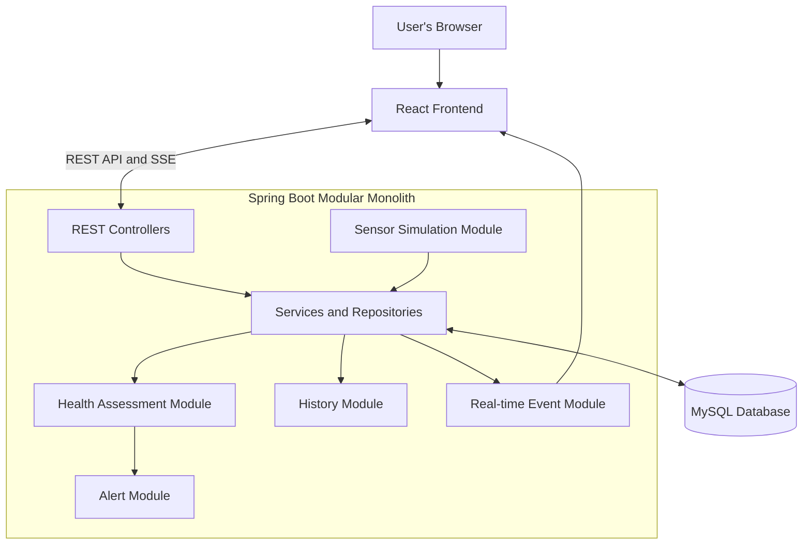
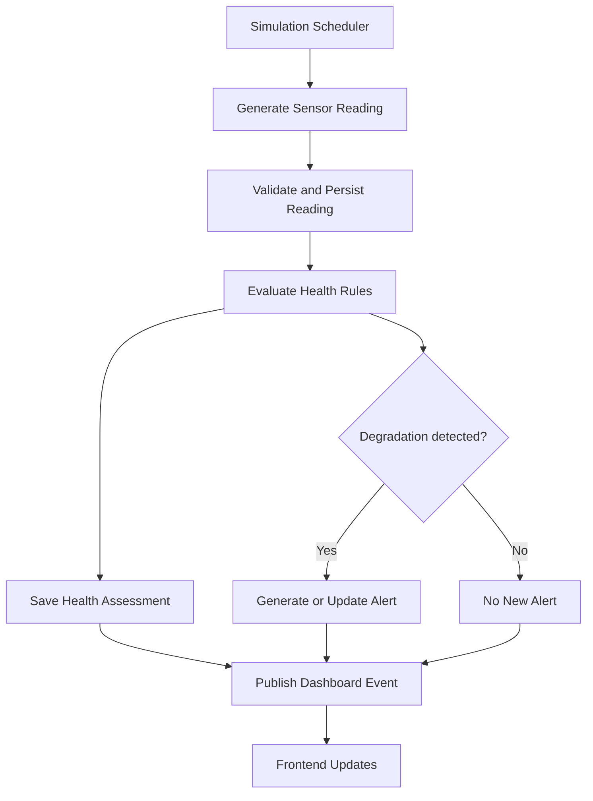
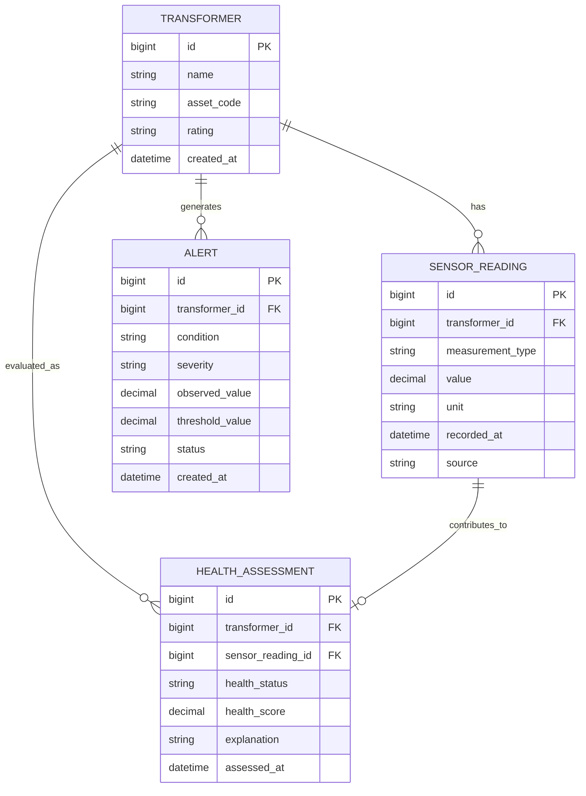
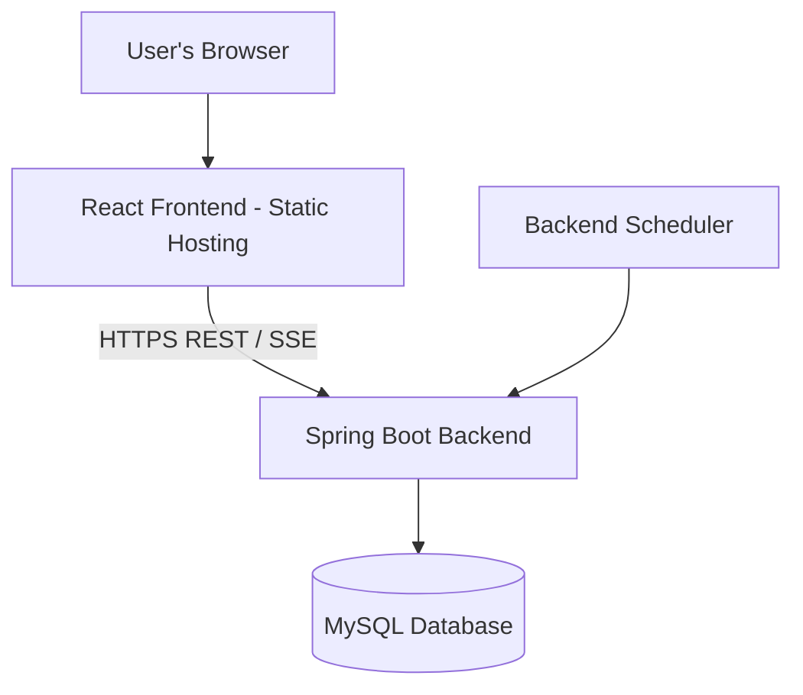

# Technical Architecture Proposal — Transformer Digital Twin

**Project:** Rugged Monitoring GBPUAT Pantnagar Take-Home Assignment  
**Track:** Software (CS and AI)  
**Selected build:** Digital Twin for a transformer  
**Document status:** Approved architecture baseline — implementation is in progress

---

## 1. Architecture objectives

The architecture should satisfy the three mandatory product capabilities:

1. Display transformer health using simulated sensor readings.
2. Generate and display alerts when the simulated health degrades.
3. Store and display historical readings and health states.

It should also support a working end-to-end demonstration, clear run instructions, and explainable design decisions.

The BRD and PRD leave the technology stack, sensor selection, simulation model, health calculation, alert thresholds, update frequency and history retention open. The architecture below proposes practical choices for these gaps. These are **implementation recommendations, not requirements imposed by Rugged Monitoring**.

**Recommendation:** use React for the frontend, Spring Boot for the backend, and MySQL for persistence. Run the sensor simulator inside the backend. Build a modular monolith rather than introducing microservices, Kafka, Kubernetes or a separate IoT platform.

This balances backend engineering depth with the assignment's 8–12-hour time budget.

## 2. High-level architecture



The application has four logical business modules inside one Spring Boot deployment. They share one database and communicate through service-layer methods. The frontend communicates with backend APIs; it does not generate authoritative sensor data or calculate authoritative health states itself.

### Why this architecture?

- **Modular monolith:** simpler to develop, test, deploy and explain than microservices.
- **Backend simulation:** gives one authoritative source of readings for the dashboard, alerts and history.
- **Relational database:** readings, assets and alerts have clear relationships.
- **REST + Server-Sent Events (SSE):** REST handles initial and historical data; SSE can push subsequent updates to the dashboard.
- **No physical sensor integration:** simulated data is sufficient for the assignment.

## 3. Recommended technology stack

| Layer | Recommended technology | Reason |
|---|---|---|
| Frontend | React + Vite | Component-based dashboard development |
| UI styling | Tailwind CSS or CSS modules | Consistent dashboard layout |
| Charts | Recharts | Sensor trends and historical graphs |
| Backend | Java 21 + Spring Boot | REST APIs, scheduling and service-layer logic |
| Persistence | Spring Data JPA + Hibernate | Entity relationships and database operations |
| Database | MySQL | Structured storage for readings, alerts and asset details |
| Live updates | Server-Sent Events (SSE) | Pushes new readings from server to browser |
| API testing | Postman | Verify endpoints and end-to-end behaviour |
| Backend testing | JUnit 5 + Mockito | Test health and alert logic |
| Frontend testing | Manual demonstration initially | Keeps initial scope manageable |
| Version control | Git + GitHub | Source code and submission |
| Deployment | Frontend hosting + backend hosting + managed MySQL | Separates UI from API while keeping deployment straightforward |

These are recommendations, not mandated technologies. MySQL and Spring Boot are reasonable choices for a conventional Java backend.

### REST and SSE: why both?

Use REST for:

- Fetching the initial dashboard state.
- Retrieving historical readings.
- Retrieving alerts.
- Starting, stopping or resetting the simulator, if those controls are included.

Use SSE for:

- Receiving newly generated readings.
- Receiving updated health states.
- Receiving newly generated alerts.

SSE is one-way communication from server to browser, which matches this dashboard's live-update needs. WebSockets would also work, but bidirectional communication is not necessary for the core requirements.

A simpler alternative is periodic REST polling. If SSE takes too much implementation time, polling every few seconds is a reasonable fallback.

## 4. Backend architecture and module responsibilities

Organize the backend around business responsibilities rather than putting all logic in controllers.

```text
backend/
└── src/main/java/com/project/digitaltwin/
    ├── DigitalTwinApplication.java
    ├── config/
    │   ├── CorsConfig.java
    │   └── AsyncConfig.java
    ├── asset/
    │   ├── AssetController.java
    │   ├── AssetService.java
    │   ├── AssetRepository.java
    │   ├── Transformer.java
    │   └── dto/
    ├── sensor/
    │   ├── SensorReading.java
    │   ├── SensorReadingRepository.java
    │   ├── SensorService.java
    │   └── dto/
    ├── simulation/
    │   ├── SimulationService.java
    │   ├── SimulationScheduler.java
    │   └── SimulationConfig.java
    ├── health/
    │   ├── HealthService.java
    │   ├── HealthAssessment.java
    │   └── HealthStatus.java
    ├── alert/
    │   ├── Alert.java
    │   ├── AlertService.java
    │   ├── AlertController.java
    │   └── AlertRepository.java
    ├── history/
    │   ├── HistoryController.java
    │   └── HistoryService.java
    ├── realtime/
    │   └── RealtimeService.java
    └── common/
        ├── exception/
        └── response/
```

The exact package names can change. The important part is preserving separation of responsibilities.

### 4.1 Asset module

Responsible for representing the transformer being monitored.

Responsibilities:

- Store transformer identity and descriptive information.
- Provide transformer details to the dashboard.
- Associate readings and alerts with the correct transformer.

The prototype seeds three demo transformers. Each reading, health assessment and alert is associated with its transformer ID. The frontend selects one transformer at a time; full asset CRUD and fleet-wide comparison are not included.

### 4.2 Simulation module

This module produces simulated sensor readings.

Recommended approach:

- Use Spring's `@Scheduled` functionality.
- Generate a new reading at a configurable interval.
- Maintain simulation state so readings change over time rather than being entirely random.
- Pass each generated reading into the same processing pipeline used by the rest of the application.

For a convincing demonstration, the simulator should support a normal operating period followed by a controlled degradation period.

| Simulation phase | Behaviour |
|---|---|
| Normal | Temperature and load fluctuate within the chosen normal operating range |
| Increasing stress | Load and temperature trend upward |
| Degraded | One or more configured degradation rules are triggered |
| Recovery | Measurements return toward normal |

These phases are proposed demo behaviour. Their values and physical assumptions need to be researched and documented.

**Important:** do not independently generate dashboard readings in React. That risks showing readings that were never stored or evaluated by the backend.

### 4.3 Health module

This module converts sensor readings into an understandable transformer health state.

Responsibilities:

1. Receive the latest valid sensor reading(s).
2. Evaluate the configured health rules.
3. Determine the current asset-health state.
4. Save a health assessment.
5. Pass degradation conditions to the alert module.

Keep health logic in a dedicated service, not in a controller or frontend component.

The PRD does not prescribe a health-score formula. A simple, explainable rule-based assessment is more appropriate than claiming to have implemented a validated predictive model.

### 4.4 Alert module

Responsible for generating and retrieving degradation alerts.

An alert may contain:

- Transformer reference.
- Triggering measurement or condition.
- Observed value.
- Configured threshold or rule.
- Severity, if severity levels are introduced.
- Creation timestamp.
- Current alert state, if an alert lifecycle is implemented.

A possible alert lifecycle is:

`ACTIVE → ACKNOWLEDGED → RESOLVED`

This is an optional design choice. The assignment only requires an alert to be generated and visible; acknowledgement and resolution are not mandatory.

Avoid creating a new alert for every scheduled reading while the same condition remains degraded. Use an active-alert check or deduplication key for the same transformer and degradation condition.

### 4.5 History module

This module retrieves information that has already been persisted.

It should support:

- Historical sensor readings.
- Historical health assessments.
- Historical alerts.
- Time-range filtering, if implemented.

History must come from stored records, not from the current simulator state. Otherwise, restarting the application could erase the demonstration's history.

### 4.6 Real-time module

This module publishes updates to connected dashboard clients.

After a reading is generated and processed, publish an event containing:

- Latest sensor values.
- Current health state.
- Any newly generated alert.

The frontend opens an SSE stream scoped to the selected transformer ID. The backend publishes each transformer update only to subscribers for that transformer.

## 5. Sensor and simulation data design

The assignment gives four example categories: temperatures, load, dissolved gas and partial discharge. It does not require all four.

For the first implementation, start with a small, manageable set of measurements.

| Measurement | Example unit | Purpose in the prototype |
|---|---|---|
| Oil temperature | °C | Shows thermal operating condition |
| Winding hot-spot temperature | °C | Represents a key thermal condition |
| Load | % of rated load | Provides operating context |
| Hydrogen (H₂) | ppm | Demonstrates dissolved-gas monitoring |
| Partial discharge | pC or another researched unit | Demonstrates an insulation-related measurement |

The units and exact parameters must be verified against appropriate technical sources before being finalized. This is a candidate selection, not a claim that all parameters are required.

For a time-constrained implementation, start with three measurements: oil temperature, winding hot-spot temperature and load. Add gas or partial-discharge simulation only if the core flow is complete.

### Proposed data flow



One generated reading should drive all downstream results. The dashboard, health assessment, alert and history should not have separate sources of truth.

## 6. Database architecture

Use a relational schema with four primary tables.

### Entity relationship overview



`health_score` is optional: include it only if the implementation defines a meaningful score. Otherwise, store a health status and explanation.

### Table responsibilities

| Table | Purpose |
|---|---|
| `transformer` | Stores the asset being monitored |
| `sensor_reading` | Stores every simulated sensor measurement |
| `health_assessment` | Stores the evaluated health state over time |
| `alert` | Stores degradation events |

### Important database decisions

1. **Store readings as timestamped records.** Do not update a single row with the latest temperature. Insert a new reading so previous measurements remain available.
2. **Store units and measurement types.** A value without its measurement type and unit is difficult to interpret.
3. **Index historical queries.** Recommended indexes:
   - `sensor_reading(transformer_id, recorded_at)`
   - `health_assessment(transformer_id, assessed_at)`
   - `alert(transformer_id, created_at)`
4. **Store timestamps consistently.** Prefer UTC in the database and display timestamps in the user's local timezone.
5. **Make data provenance explicit.** A `source` field can identify records as `SIMULATED`, helping avoid misrepresenting the demonstration as physical sensor data.

## 7. API architecture

The following API design is a proposal based on the PRD's user flows. These endpoints are not prescribed by the assignment.

| Method | Endpoint | Responsibility |
|---|---|---|
| GET | `/api/transformers` | List available transformers |
| GET | `/api/transformers/{id}` | Retrieve transformer details |
| GET | `/api/transformers/{id}/dashboard` | Retrieve latest readings and health state |
| GET | `/api/transformers/{id}/readings/latest` | Retrieve latest sensor measurements |
| GET | `/api/transformers/{id}/history` | Retrieve historical readings |
| GET | `/api/transformers/{id}/health/history` | Retrieve historical health assessments |
| GET | `/api/transformers/{id}/alerts` | Retrieve transformer alerts |
| GET | `/api/transformers/{id}/events` | Establish SSE connection |
| POST | `/api/simulation/start` | Start simulation, if a control is provided |
| POST | `/api/simulation/stop` | Stop simulation, if a control is provided |
| POST | `/api/simulation/reset` | Reset demo state, if implemented |

For history, support optional query parameters such as:

```text
/api/transformers/1/history?from=2026-11-22T00:00:00Z&to=2026-11-22T12:00:00Z
```

The backend should return DTOs rather than exposing JPA entities directly.

### Example dashboard response

```json
{
  "transformerId": 1,
  "assetName": "Transformer T-01",
  "source": "SIMULATED",
  "healthStatus": "NORMAL",
  "lastUpdated": "2026-11-22T10:30:00Z",
  "readings": [
    {
      "type": "OIL_TEMPERATURE",
      "value": 68.5,
      "unit": "°C"
    },
    {
      "type": "LOAD",
      "value": 75,
      "unit": "%"
    }
  ]
}
```

This is an illustrative response contract, not a finalized schema. Actual fields should match the selected simulation model.

## 8. Health assessment and alert architecture

This is the most important domain-specific part of the project. A dashboard with attractive charts is not enough: it must demonstrate why a transformer is considered degraded.

### Recommended approach: explainable rule-based health assessment

Start with explicit rules based on researched operating guidance.

Conceptually:

```text
IF configured thermal degradation condition is met:
    mark thermal condition as degraded

IF configured gas degradation condition is met:
    mark gas condition as degraded

IF any configured critical condition is met:
    generate an alert

Otherwise:
    retain the normal health state
```

This is not a validated transformer diagnostic algorithm. The actual conditions, limits and interpretation require research.

### Separate measurement conditions from overall health

Keep two concepts separate:

- **Measurement condition:** whether an individual parameter is within its configured limits.
- **Overall health state:** the summary produced by evaluating the available measurement conditions.

This makes the explanation more useful. A user should be able to see which condition caused the overall status to deteriorate.

### Suggested alert fields

| Field | Purpose |
|---|---|
| Condition | Identifies the rule that triggered |
| Observed value | Shows the measured simulated value |
| Threshold | Shows the configured comparison value |
| Severity | Optional classification |
| Status | Active, acknowledged or resolved |
| Created at | Shows when degradation was detected |

The system should avoid duplicate active alerts for the same continuing condition.

### Important limitation

A rule-based prototype demonstrates condition-monitoring logic. It does not establish that the application can predict transformer failures, estimate remaining useful life or make operational loading decisions. Those capabilities are not required by the PRD.

## 9. Frontend architecture and UI/UX

The frontend should be a monitoring dashboard, not a general-purpose administration application.

I recommend four primary views:

### 9.1 Transformer overview

Display:

- Transformer name and asset details.
- Overall health status.
- Latest sensor values.
- Last updated timestamp.
- Active alert count.

### 9.2 Sensor monitoring

Display:

- Temperature and load cards.
- Current measurement values.
- Live trend charts.
- Clear measurement units.
- Simulated-data indicator.

### 9.3 Alerts

Display:

- Active degradation alerts.
- Triggering parameter.
- Observed value and configured threshold.
- Timestamp and status.

### 9.4 Historical analysis

Display:

- Historical sensor trends.
- Time-range filtering.
- Previous health states.
- Historical alerts.

These are proposed layouts, not existing Rugged Monitoring screens or assignment requirements.

### Suggested frontend component structure

```text
frontend/src/
├── components/
│   ├── layout/
│   │   ├── Sidebar.jsx
│   │   └── Topbar.jsx
│   ├── dashboard/
│   │   ├── HealthCard.jsx
│   │   ├── SensorCard.jsx
│   │   └── HealthOverview.jsx
│   ├── charts/
│   │   ├── TemperatureChart.jsx
│   │   └── LoadChart.jsx
│   └── alerts/
│       └── AlertList.jsx
├── pages/
│   ├── DashboardPage.jsx
│   ├── AlertsPage.jsx
│   └── HistoryPage.jsx
├── services/
│   ├── api.js
│   ├── transformerService.js
│   ├── historyService.js
│   └── alertService.js
├── hooks/
│   └── useLiveUpdates.js
└── App.jsx
```

### UX principles

- Show the overall health state before detailed measurements.
- Use consistent units throughout the application.
- Show the last update time so users can tell whether data is fresh.
- Clearly label simulated data.
- Explain why an alert was generated.
- Keep live and historical information visually distinct.
- Show a meaningful empty or unavailable state when readings are missing.

Avoid excessive animations, unnecessary 3D models and complicated navigation. They do not improve the three mandatory flows enough to justify the implementation effort.

## 10. End-to-end execution flow

The main demonstration should follow this sequence:

1. **Application starts:** Spring Boot connects to MySQL and seeds the demo transformer fleet when the corresponding asset codes are missing.
2. **Simulator starts:** the scheduler generates simulated sensor readings.
3. **Readings are saved:** the backend validates and stores readings with timestamps.
4. **Health is evaluated:** the health service applies the documented rules and stores the assessment.
5. **Alert is generated:** if a degradation condition is met, the alert service creates an alert.
6. **Dashboard updates:** the backend publishes the new state using SSE.
7. **History is available:** the user opens the history screen and reviews earlier readings and health states.

This directly demonstrates the simulated data, live health view, degradation alerts and reviewable history.

## 11. Deployment architecture

For the prototype, keep deployment simple:



Recommended deployment arrangement:

- React frontend on a static frontend hosting platform.
- Spring Boot backend on a Java-compatible application host.
- MySQL on a managed database service.
- Environment variables for database credentials and frontend API URL.
- HTTPS for communication between frontend and backend.

The assignment does not prescribe a hosting provider. The final choice should depend on deployment reliability and time available.

### Deployment considerations

- Configure CORS for the deployed frontend origin.
- Configure the database to accept connections from the backend host.
- Keep secrets out of GitHub.
- Ensure the backend host does not suspend the simulator during the demo.
- Confirm SSE connections work through the hosting platform and any reverse proxy.
- Provide a fallback demo video if deployment is unreliable.

## 12. Security, reliability and error handling

Authentication is not required by the assignment. Do not introduce JWT or role-based access control in the first version unless there is a specific reason.

Basic safeguards are still appropriate:

| Area | Recommendation |
|---|---|
| API validation | Validate measurement types, timestamps and values |
| Database | Use JPA parameters and transactions appropriately |
| Secrets | Store credentials in environment variables |
| CORS | Allow only the frontend origin |
| Error handling | Use a centralized exception handler |
| Missing readings | Show unavailable rather than assuming normal health |
| Simulator failure | Show that new data is no longer arriving |
| SSE disconnect | Reconnect and fetch the latest dashboard state |
| Duplicate alerts | Check existing active alerts before creating another |

Do not claim industrial-grade security, high availability or regulatory compliance from these basic measures.

## 13. Testing strategy

Testing should focus on proving that the complete flow works.

| Test | What it verifies |
|---|---|
| Simulator test | New readings are generated |
| Persistence test | Readings are saved with timestamps |
| Health service test | Correct health state is returned for test inputs |
| Alert test | Configured degradation creates an alert |
| Duplicate alert test | Continuing degradation does not create unwanted duplicates |
| History test | Older readings remain retrievable |
| API test | Dashboard and history endpoints return expected data |
| SSE test | New readings reach connected clients |
| End-to-end test | A simulated degradation is visible in the dashboard and history |

For the health and alert modules, use fixed test inputs rather than relying on random simulator output. This makes tests repeatable.

## 14. Architecture decisions and trade-offs

| Decision | Recommendation | Trade-off |
|---|---|---|
| Backend architecture | Modular monolith | Less independent scaling, much simpler development |
| Sensor simulation | Backend scheduler | Not a physical IoT ingestion pipeline, but a consistent source of data |
| Database | MySQL | Less specialized time-series functionality than a time-series database, but simpler for this project |
| Live updates | SSE | One-way communication, sufficient for dashboard updates |
| Health logic | Explainable rules | Not predictive AI or a validated diagnostic model |
| Frontend charts | Recharts | Fast to build, sufficient for selected measurements |
| Authentication | Omit initially | No user-specific access control |
| Deployment | Separate frontend and backend | Two deployments to configure, but straightforward hosting |

### Why not Kafka, microservices or TimescaleDB?

These technologies may be appropriate in a larger production monitoring platform. This prototype has one simulated data source, one asset and a small number of application modules.

Adding distributed messaging, multiple deployable services and a specialized time-series database would increase setup and debugging time without directly satisfying another assignment requirement.

A well-structured monolith is a stronger choice for this submission.

## 15. Decisions to finalize before implementation

The architecture is proposed, but some domain and implementation details still need explicit decisions.

| Decision | Suggested starting point | Why it matters |
|---|---|---|
| Sensor selection | Oil temperature, hot-spot temperature and load | Small but meaningful initial dataset |
| Simulation interval | 5 seconds | Makes the live flow easy to demonstrate |
| Simulation behaviour | Normal → degradation → recovery | Demonstrates alerts and changing health |
| Health model | Rule-based, with documented sources and assumptions | Explainable and achievable |
| Health representation | Normal / Warning / Critical | Easy to understand; exact criteria still need research |
| Alert handling | Active alerts with duplicate suppression | Prevents alert flooding |
| History | Persist all generated readings during the demo | Ensures history remains meaningful |
| Live update | SSE, with REST polling as fallback | Near-real-time dashboard updates |
| Transformer count | One | Keeps implementation focused |

The proposed 5-second interval and status names are prototype assumptions, not technical limits or company-defined standards.

## 16. Recommended implementation order

Given the assignment's 8–12-hour budget, build in this order:

1. **Database and backend foundation:** create transformer and sensor-reading entities, repositories and basic REST APIs.
2. **Sensor simulator:** generate readings and persist them. Verify that values change over time.
3. **Health assessment:** implement and test the documented rule-based logic.
4. **Alert generation:** create alerts when health assessment detects degradation.
5. **History APIs:** make readings and previous health states retrievable.
6. **Frontend dashboard:** build overview, sensor charts, alerts and history.
7. **Live updates and final demo:** add SSE or polling, then test the full normal-to-degraded-to-history flow.

If time becomes tight, prioritize a working REST-based dashboard and history over SSE. A reliable end-to-end flow is more valuable than a sophisticated update mechanism that is not fully tested.

## 17. Final recommendation

Proceed with:

**React + Spring Boot + MySQL**

- Modular monolithic backend.
- Backend scheduled sensor simulation.
- Rule-based transformer health assessment.
- Alert generation with duplicate suppression.
- Timestamped historical readings and assessments.
- REST APIs + SSE for dashboard updates.
- Four focused dashboard views.

**Core demonstration:** simulated readings change → health degrades → alert appears → history records the event.

The most important design decision is to make the sensor simulator, health evaluator, alert generator and history storage part of one consistent processing pipeline. That makes the project a working Digital Twin prototype rather than just a dashboard displaying random numbers.

**Before writing application code:** finalize the sensor parameters, research-backed degradation rules and simulation assumptions. Document which choices are based on external technical sources and which are prototype assumptions.
